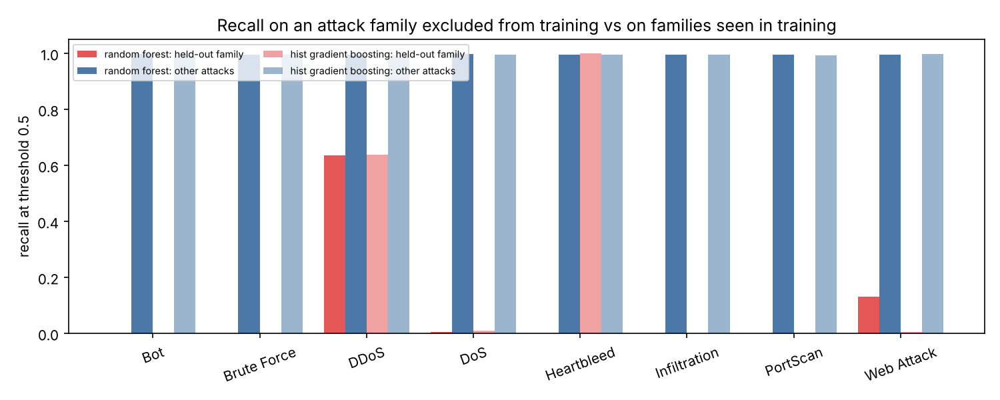
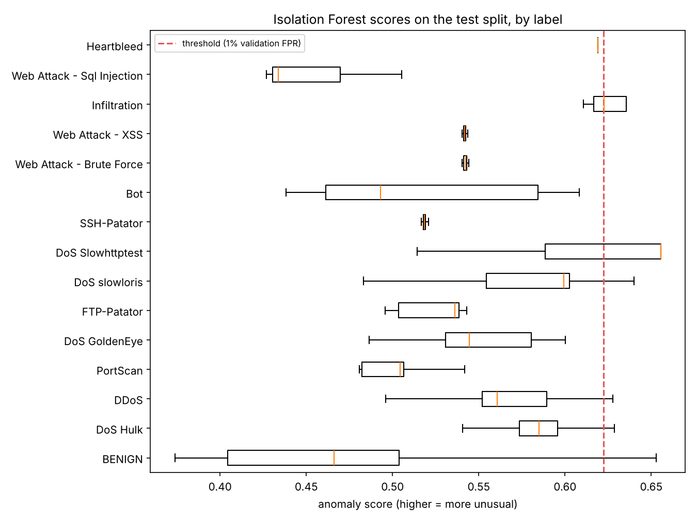
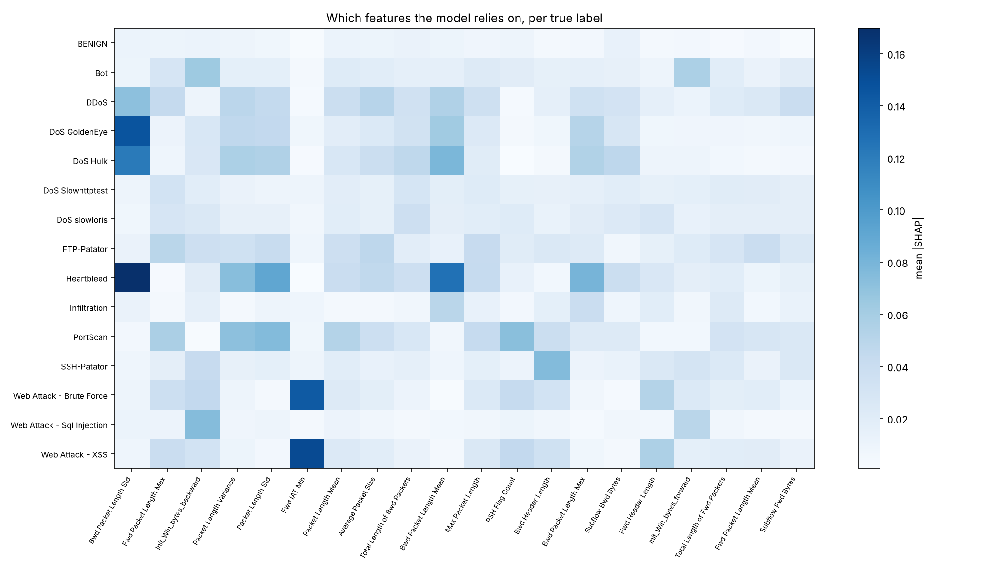
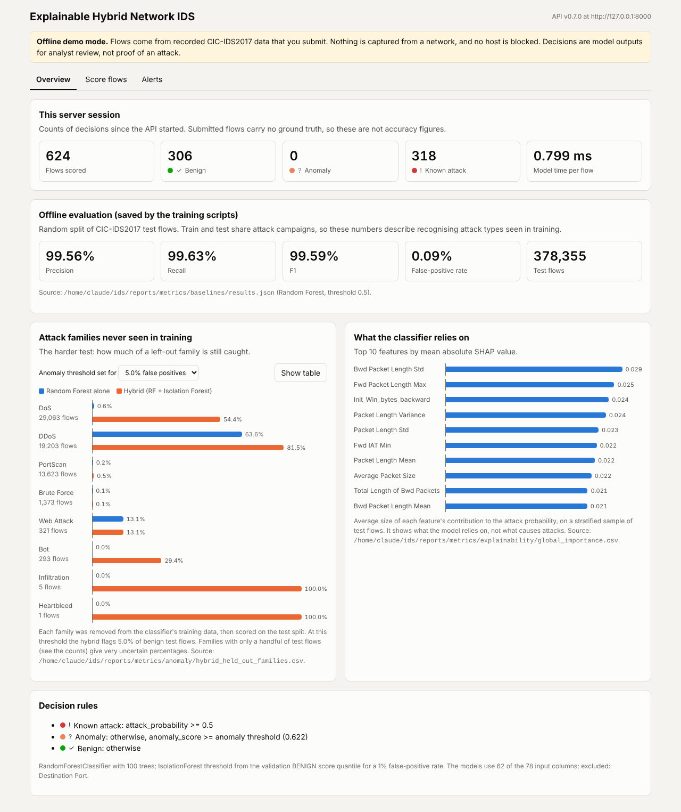
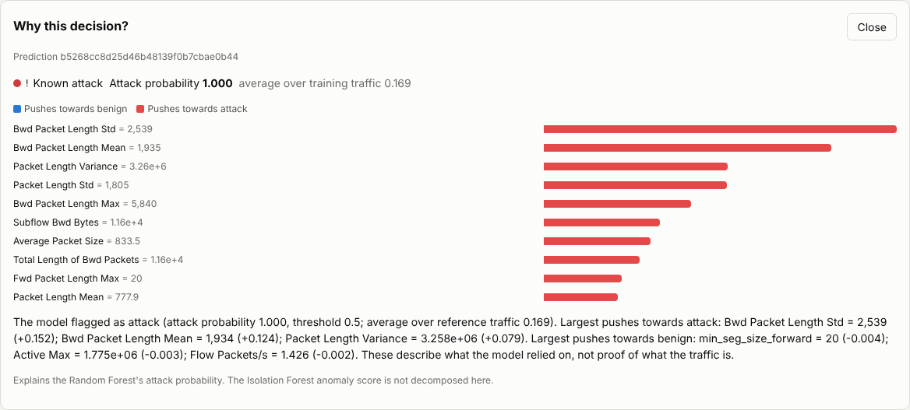
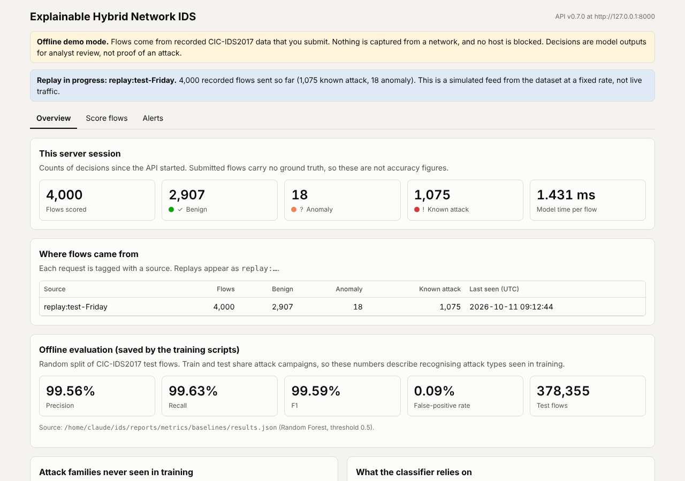

# Explainable Hybrid Network Intrusion Detection System

A research-oriented network intrusion detection system (NIDS) built on the
CIC-IDS2017 flow features: a supervised Random Forest, an unsupervised
Isolation Forest, SHAP explanations, a FastAPI backend and a React dashboard.

This is an academic portfolio project. It does not claim production-grade
security or guaranteed detection of unseen ("zero-day") attacks.

## Status

| Phase | What | State |
|---|---|---|
| 1 | Dataset discovery, inspection and EDA | **Done** (all 8 files, see below) |
| 2 | Cleaning and leakage-safe preprocessing | **Done** (see below) |
| 3 | Baseline models (LR, DT, RF, HistGradientBoosting) | **Done** (random split; see below) |
| 4 | Leakage control and held-out attack-family evaluation | **Done** (see below) |
| 5 | Isolation Forest and hybrid decision policy | **Done** (see below) |
| 6 | SHAP explanations | **Done** (see below) |
| 7 | FastAPI backend | **Done** (offline mode; see below) |
| 8 | React dashboard | **Done** (offline demo mode; see below) |
| 9 | Dataset replay | **Done** (simulated feed; see below). Optional live flows in an authorised lab: not built |
| 10 | Optional reinforcement-learning response simulation | Planned |

Every dataset number or model result in this README was produced by the code
in this repository.

## Project layout (current)

```
data/raw/           original CSVs or MachineLearningCSV.zip (never modified, not in Git)
data/processed/     generated samples and, later, cleaned data (not in Git)
notebooks/          01_dataset_inspection, 02_exploratory_data_analysis
src/data/io.py      file discovery, encoding detection, header normalisation, chunked reading
src/data/inspect_dataset.py   streaming statistics, duplicates, samples
src/data/eda.py     figures, correlation analysis, generated report
src/data/labels.py  label normalisation, label -> family -> binary mapping
src/data/preprocess.py        de-duplication, float32 parquet, stratified split
src/features/feature_pipeline.py  scikit-learn preprocessing fitted on train only
src/models/train.py, evaluate.py, predict.py  baselines, metrics, scoring CSVs
src/models/generalization.py  held-out family / day experiments, port ablation
src/anomaly/isolation_forest.py  benign-only anomaly detector, hybrid policy
src/explainability/shap_explainer.py  per-flow and global SHAP explanations
backend/            FastAPI service: main.py, schemas.py, services/ (detector, store, reports)
examples/           request bodies built from real test-split flows, requests.http
frontend/           React + TypeScript dashboard (Vite)
src/replay/replay.py  replays recorded flows through the API at a set rate
reports/            dataset_inspection.md, figures/inspection/, metrics/inspection/
tests/              pytest suite using small hand-built CSVs
```

Folders for later phases are created when those phases are built, so the tree only shows what exists.

## Setup (Windows, VS Code)

```powershell
cd ids
py -3.12 -m venv .venv
.venv\Scripts\Activate.ps1
python -m pip install --upgrade pip
pip install -r requirements.txt
python -m pytest
```

On macOS/Linux use `python3 -m venv .venv` and `source .venv/bin/activate`.
In VS Code, pick `.venv` with *Python: Select Interpreter*.

## Dataset

1. Download `MachineLearningCSV.zip` from the Canadian Institute for
   Cybersecurity CIC-IDS2017 page (https://www.unb.ca/cic/datasets/ids-2017.html).
2. Put either the zip itself or its extracted `.csv` files anywhere under
   `data/raw/`. The code reads CSVs straight from the zip, so extracting is
   optional. If both exist, the extracted copy is used and the zip member is
   skipped so no row is counted twice.

## Phase 1: inspection and EDA

```powershell
python -m src.data.inspect_dataset --raw-dir data/raw
python -m src.data.eda
```

The first command streams every file in 200,000-row chunks, so the full
dataset never sits in memory at once. The second makes the figures and writes
`reports/dataset_inspection.md`. On a synthetic file of the same width the
scan ran at roughly 25,000 rows per second with about 1 GB peak memory; real
timings will be recorded after the first real run.

Outputs:

| File | Contents |
|---|---|
| `reports/dataset_inspection.md` | Generated report; every number is measured |
| `reports/metrics/inspection/summary.json` | Headline facts (files, rows, labels, constant / identical / identifier columns, duplicates) |
| `reports/metrics/inspection/files.csv` | Per file: encoding, rows, unparsed lines, header whitespace, duplicate column names |
| `reports/metrics/inspection/label_distribution.csv` | Label x file counts |
| `reports/metrics/inspection/column_stats.csv` | Per feature: NaN, +inf, -inf, unparseable, mean, std, min, max, zeros, negatives |
| `reports/metrics/inspection/nonfinite_by_file.csv` | NaN / inf counts per file and column |
| `reports/metrics/inspection/duplicates_by_label.csv`, `duplicates_by_file.csv` | Redundant duplicate copies |
| `reports/metrics/inspection/correlated_pairs.csv` | Feature pairs with \|r\| >= 0.95 |
| `reports/figures/inspection/*.png` | Class distribution, labels by file, feature distributions, correlation heatmap |

### Design decisions in Phase 1

* **Read-only and reproducible.** Raw files are opened read-only (a test
  checks they are byte-for-byte unchanged). Samples use a fixed seed.
* **Encoding is detected, not assumed.** Each file is checked as UTF-8 first,
  then cp1252, then latin-1. Some CIC-IDS2017 copies have a non-UTF-8 dash in
  the web-attack labels; the label is kept exactly as decoded and flagged as
  non-ASCII so Phase 2 can normalise it deliberately.
* **Headers are normalised in one place.** Surrounding whitespace is stripped
  and repeated names get a `.1` suffix (CIC-IDS2017 is known to repeat
  `Fwd Header Length`), so nothing is silently dropped. The label column is
  located by name and the run stops if it is missing or ambiguous.
* **Files must share a schema.** A file with different columns stops the run
  instead of being merged with misaligned features.
* **Malformed input is counted, not hidden.** Lines the CSV parser cannot read,
  completely empty rows, NaN, +inf, -inf and non-numeric cells are each
  counted separately (`nan` counts every missing value after parsing,
  including unparseable cells, which are also counted on their own).
* **Duplicates are measured because they cause leakage.** If identical flows
  land in both train and test, test scores partly measure memorisation. The
  scan reports exact duplicates within and across files, per label, and
  feature vectors that appear with different labels (which no model can
  classify perfectly). Rows are compared by 64-bit hashes; with a few million
  rows a false match is vanishingly unlikely (about 1 in 10 million).
* **Statistics are exact; plots use samples.** Counts, means and standard
  deviations use every row (mean and variance with a numerically stable
  streaming update). Plots use two exact random samples: a uniform one that
  keeps the real class mix (for correlations), and a stratified one with up
  to 5,000 rows per label so rare attacks such as Heartbleed are visible (for
  per-class plots). The stratified sample must never be used to estimate class
  proportions.
* **Identifier-like columns are flagged, not dropped yet.** Columns such as
  `Destination Port` can act as shortcuts to the label. Phase 2 decides on
  them with evidence and documents the trade-off.
* **No seaborn.** Matplotlib covers every Phase 1 plot, so one fewer dependency.

### Phase 1 findings (full MachineLearningCSV, 8 files)

Measured by the commands above; full detail in `reports/dataset_inspection.md`.

* **2,830,743 rows, 78 features + `Label`, 15 labels.** 80.30% BENIGN. The
  rarest classes are tiny: Infiltration 36, Web Attack Sql Injection 21,
  Heartbleed 11 rows. Accuracy is therefore meaningless as a headline metric:
  predicting BENIGN for everything already scores 80.3%.
* **Every attack label occurs in exactly one file (one day).** BENIGN appears
  in all eight. A split by day therefore means the test day's attacks were
  never seen in training. That is the held-out-attack experiment, not a
  normal supervised test, and the evaluation design in Phase 4 has to treat
  it that way.
* **All files parse cleanly as UTF-8 with identical headers** (whitespace in
  65 of 79 names, `Fwd Header Length` duplicated). The three web-attack labels
  contain the Unicode replacement character (`Web Attack � Brute Force`), so
  the original dash was already lost before distribution; Phase 2 maps them
  to `Web Attack - ...`.
* **Non-finite values are confined to two rate columns:** `Flow Bytes/s`
  (1,358 NaN, 1,509 +inf) and `Flow Packets/s` (2,867 +inf). These are rates
  divided by a zero duration.
* **10.89% of rows (308,381) are redundant exact duplicates**, 256,479 within
  a file and 51,902 across files. They are concentrated in attacks:
  45.4% of SSH-Patator, 42.9% of PortScan, 25.3% of FTP-Patator and 25.2% of
  DoS Hulk rows are repeats. A random row split would put copies of the same
  flow on both sides and inflate test scores, so duplicates are removed
  before splitting.
* **698 feature vectors appear with two labels** (7,020 rows), mostly
  BENIGN vs PortScan (564) and BENIGN vs DoS Hulk (130). These flows are
  indistinguishable from the features alone, so no model can be perfect on them.
* **Unusable columns:** 8 columns are constant over the whole dataset (all
  `Bulk` rate fields plus `Bwd PSH Flags`, `Bwd URG Flags`), and 5 pairs of columns
  are exact copies (`Total Fwd Packets` = `Subflow Fwd Packets`,
  `Total Backward Packets` = `Subflow Bwd Packets`, `Fwd PSH Flags` =
  `SYN Flag Count`, `Fwd URG Flags` = `CWE Flag Count`, and the duplicated
  `Fwd Header Length`). Some identities found in a single file (for example
  `Subflow Fwd Bytes`) do not hold globally, which is why they are measured on
  all rows rather than a sample.
* **`Destination Port`** is the only identifier-like column; there are no
  IPs, timestamps or flow IDs in this release of the CSVs.

## Phase 2: cleaning and preprocessing

```powershell
python -m src.data.preprocess            # -> data/processed/flows.parquet (+ split column)
python -m src.features.feature_pipeline  # -> models/preprocessor_tree.joblib, preprocessor_scaled.joblib
```

To follow the steps interactively, open `notebooks/03_preprocessing.ipynb`.
It runs each step on one day file and shows its effect, calling the same
functions as the scripts.

The work is split between two places on purpose:

* **Fixed, data-independent steps** run once in `src/data/preprocess.py`:
  label normalisation, exact-duplicate removal, float32 storage and the split.
  None of them looks at feature distributions, so none can leak test
  information into a model.
* **Learned steps** live in a scikit-learn `Pipeline` (`src/features/feature_pipeline.py`)
  that is fitted on the training split only and saved with joblib: schema
  enforcement, excluding `Destination Port`, turning +/-inf into missing,
  dropping columns that are constant or duplicated *in the training data*,
  median imputation, and (for scale-sensitive models only) a signed log
  transform plus standardisation.

| Decision | Why | Trade-off |
|---|---|---|
| Remove exact duplicates (same features and label) before splitting | Otherwise copies of one flow land in train and test and inflate scores | Changes class frequencies (PortScan loses 43%), so per-class counts differ from the raw dataset |
| Keep same-features/different-label rows | The ambiguity is real; hiding it would flatter the model | Caps achievable precision on BENIGN vs PortScan / DoS Hulk |
| Restore the lost dash in web-attack labels; list every label explicitly | Readable labels; an unknown label must fail loudly | New label spellings need one line added |
| Group labels into families (DoS, Brute Force, Web Attack, ...) | Holding out "an unseen attack" must remove all variants of it | Family boundaries are a judgement call, documented in `labels.py` |
| Exclude `Destination Port` by default | Measured on the cleaned data, the port nearly identifies some labels: FTP-Patator goes to port 21 and SSH-Patator to 22 in over 99.9% of flows, and Heartbleed and Infiltration always go to 444. That is a property of this lab setup, not of the attacks, so it would not transfer to other networks | May cost some accuracy; Phase 4 retrains with it to measure how much |
| inf -> NaN -> training median | Infinity comes from dividing by a zero duration; clipping would invent a value | Imputed rows look like typical flows on those two columns |
| Drop constant/duplicate columns learned on train | Removes 15 useless inputs without letting test data decide anything | Recomputed if the training data changes |
| Float32 storage | Halves memory to fit 8 GB laptops | ~7 significant digits; two pairs that differ only beyond that (`Avg Fwd/Bwd Segment Size` vs packet-length means) become identical and are dropped as duplicates |
| Stratified 70/15/15 split by fine label | Every class, even Heartbleed, appears in train, validation and test | Random split = same days in train and test; it measures in-distribution performance only. Day- and family-held-out splits come in Phase 4 |

Measured results (full dataset):

* 2,830,743 rows in, **2,522,362 after removing 308,381 exact duplicates**
  (BENIGN 176,613, PortScan 68,111, DoS Hulk 58,224, SSH-Patator 2,678,
  FTP-Patator 2,005, others under 500).
* Split: **1,765,653 train / 378,354 validation / 378,355 test**. The smallest
  classes are very small in evaluation: Heartbleed 8/2/1, Sql Injection
  15/3/3, Infiltration 25/6/5. Per-class metrics for these are anecdotes, not
  estimates, and will be reported with their counts.
* The fitted pipeline maps **78 input features to 62 model features**:
  `Destination Port` excluded, 8 constant columns dropped, and 7 duplicates
  dropped (`SYN Flag Count`, `CWE Flag Count`, `Avg Fwd Segment Size`,
  `Avg Bwd Segment Size`, `Fwd Header Length.1`, `Subflow Fwd Packets`,
  `Subflow Bwd Packets`). Full record: `reports/metrics/preprocessing/`.

## Phase 3: baseline binary models

```powershell
python -m src.models.train      # about 10 minutes on 4 cores for the full dataset
python -m src.models.predict --input some_flows.csv --output predictions.csv
```

Target: BENIGN = 0, any attack = 1. Every model is fitted on the training
split, the best one is chosen by **validation F1** (decided before looking at
test), and the test split is scored once. Threshold 0.5 for all models.

Test split, 378,355 flows (63,882 attacks), measured:

| Model | Accuracy | Precision | Recall | F1 | FPR | ROC-AUC | PR-AUC | False alarms | Missed attacks | Fit (s) | µs/flow |
|---|---|---|---|---|---|---|---|---|---|---|---|
| Majority class (always BENIGN) | 0.8312 | 0 | 0 | 0 | 0 | 0.5 | 0.1688 | 0 | 63,882 | 0.1 | 2.0 |
| Logistic Regression | 0.9799 | 0.9526 | 0.9271 | 0.9396 | 0.94% | 0.9934 | 0.9721 | 2,949 | 4,660 | 71 | 3.7 |
| Decision Tree | 0.9988 | 0.9954 | 0.9976 | 0.9965 | 0.093% | 0.9985 | 0.9955 | 293 | 154 | 125 | 7.8 |
| Random Forest (100 trees) | 0.9986 | 0.9956 | 0.9963 | 0.9960 | 0.089% | 0.9999 | 0.9996 | 281 | 237 | 203 | 9.5 |
| HistGradientBoosting | 0.9987 | 0.9955 | 0.9968 | 0.9962 | 0.091% | 0.99995 | 0.9997 | 287 | 203 | 42 | 4.2 |

(µs/flow is end-to-end on 100,000 raw test rows including preprocessing, on
the 4-core build machine; it will differ on yours.)

What this shows, and what it does not:

* **Accuracy is not informative here.** Predicting BENIGN for every flow
  scores 83.1% accuracy while detecting nothing. Recall, false-positive rate
  and PR-AUC separate the models; accuracy barely does.
* **Linear separation is not enough.** Logistic Regression misses 7.3% of
  attacks and raises 10x more false alarms. Per label it detects almost no
  SSH-Patator (0.8%), FTP-Patator (32%), Bot or web attacks (0%).
* **The three tree models are statistically indistinguishable at this
  threshold.** Their F1 scores differ by 0.0006, a few dozen flows out of
  378,355. The Decision Tree won the pre-declared rule (validation F1) and is
  saved as `models/binary_best.joblib`, but Random Forest and
  HistGradientBoosting rank flows better (PR-AUC 0.9996-0.9997 vs 0.9955),
  which matters once the threshold is tuned. The Random Forest is also saved
  (`binary_random_forest.joblib`) because the hybrid detector is built on it.
* **Per-attack recall (`reports/metrics/baselines/per_label_test.csv`) shows
  where the errors are.** Every tree model detects 97-100% of DoS, DDoS,
  PortScan, brute-force and most web-attack flows. Bot is the hardest class
  (66-79%). Infiltration (5 test flows), Sql Injection (3) and Heartbleed (1)
  are too small for their rates to mean anything.
* **These scores are in-distribution.** The split is random across all days,
  so the same attack campaigns appear in train and test. Near-perfect scores
  are typical of CIC-IDS2017 under this protocol and should not be read as
  real-world performance. Phase 4 holds out whole days and attack families to
  measure generalisation.

## Phase 4: generalisation beyond the training distribution

```powershell
python -m src.models.generalization   # about 45 minutes on 4 cores
```

Phase 3's near-perfect scores came from a random split, where train and test
share the same attack campaigns. Three harder tests, each with preprocessing
refitted on its own training rows and the threshold fixed at 0.5 (tuning it
on held-out attacks would use test labels):

**1. Leave one attack family out.** Every flow of family F is removed from
training; the model is scored on the normal test split. Recall on F is the
detection rate for an attack type the classifier never saw.

| Held-out family (test flows) | RF recall on it | HGB recall on it | RF recall on other attacks | RF FPR | RF ROC-AUC, held-out vs BENIGN |
|---|---|---|---|---|---|
| Bot (293) | 0.0% | 0.0% | 99.7% | 0.080% | 0.52 |
| Brute Force (1,373) | 0.07% | 0.07% | 99.6% | 0.090% | 0.64 |
| DDoS (19,203) | 63.7% | 63.8% | 99.5% | 0.089% | 0.88 |
| DoS (29,063) | 0.6% | 1.1% | 99.7% | 0.058% | 0.97 |
| PortScan (13,623) | 0.17% | 0.21% | 99.5% | 0.044% | 0.58 |
| Web Attack (321) | 13.1% | 0.6% | 99.6% | 0.090% | 0.97 |
| Infiltration (5) | 0% | 0% | 99.6% | 0.087% | 0.99 |
| Heartbleed (1) | 0% | 100% | 99.6% | 0.089% | 0.99 |



**2. Held-out day.** Train on Monday-Thursday (all rows), test on all of
Friday (395,106 BENIGN and 220,788 attack flows, all of them Bot, PortScan or
DDoS, none seen before Friday). Random Forest catches 29.1% of Friday's
attacks (DDoS 50.1%, PortScan 0.16%, Bot 0%) at 0.033% FPR;
HistGradientBoosting catches 0.11%.

**3. Destination Port.** Retraining the Random Forest with the port on the
random split leaves F1 unchanged (0.9958 vs 0.9959) and lowers FPR from
0.089% to 0.070%. Excluding it costs almost nothing in-distribution, so it
stays excluded.

What this means:

* **The supervised model recognises attacks it was trained on, not attacks in
  general.** Removing a family from training drops recall on it from ~99% to
  under 1% for Bot, Brute Force, DoS and PortScan, and to 13% (RF) or 0.6%
  (HGB) for web attacks. Only DDoS is partly caught (64%), plausibly because
  it resembles the DoS floods still in training.
* **It still ranks some unseen attacks above benign traffic** (ROC-AUC 0.97 for
  held-out DoS and Web Attack) but scores them below 0.5. A lower threshold
  would catch more, at a false-alarm cost that cannot be set honestly without
  labels for the unseen attack, which motivates an anomaly detector.
* **The random-split numbers from Phase 3 should be read as an upper bound,**
  and the leave-one-out and held-out-day numbers as a more realistic picture.
  Rows for Infiltration (5 test flows) and Heartbleed (1) are anecdotes.
* The two models differ a lot on the held-out day (29% vs 0.1%) despite
  near-identical random-split scores, which shows how unstable unseen-attack
  detection by a supervised model is.

## Phase 5: Isolation Forest and the hybrid decision policy

```powershell
python -m src.anomaly.isolation_forest   # about 1 minute; needs Phase 3 and 4 outputs for the hybrid tables
```

The detector is trained on **BENIGN training flows only** (1,467,539), using
the scaled preprocessing (signed log transform and standardisation, because
Isolation Forest splits uniformly between a feature's min and max). Its
threshold is set on **validation BENIGN flows only**, at a target
false-positive rate (1% and 5%). No attack label is used anywhere in it.

**Hybrid policy:** classifier probability >= 0.5 -> `known_attack`; otherwise,
anomaly score >= threshold -> `anomaly` (sent for analyst review, not called
malicious); otherwise `benign`. The anomaly detector can only add alerts.

Isolation Forest alone, test split (63,882 attacks, 314,473 BENIGN):

| Threshold | Recall | Precision | FPR | ROC-AUC | PR-AUC |
|---|---|---|---|---|---|
| 1% validation FPR | 1.1% | 18.6% | 1.00% | 0.876 | 0.497 |
| 5% validation FPR | 35.2% | 59.1% | 4.96% | 0.876 | 0.497 |

Hybrid on held-out families (Random Forest trained without the family, as in
Phase 4; the same Isolation Forest throughout):

| Held-out family | RF alone | Hybrid @1% | Hybrid @5% |
|---|---|---|---|
| Bot | 0.0% | 0.0% | 29.4% |
| Brute Force | 0.07% | 0.07% | 0.07% |
| DDoS | 63.7% | 63.7% | 81.5% |
| DoS | 0.6% | 2.9% | 54.4% |
| PortScan | 0.17% | 0.48% | 0.53% |
| Web Attack | 13.1% | 13.1% | 13.1% |
| Infiltration (5 flows) | 0% | 60% | 100% |
| BENIGN flagged (FPR) | 0.04-0.09% | 1.03-1.08% | 4.98-5.03% |



What this means:

* **At a 1% false-alarm budget the anomaly detector adds very little.** Most
  attack flows score inside the range of normal benign variation (box plot
  above), so only the most extreme ones cross the threshold.
* **At 5% it recovers part of the volumetric attacks the classifier missed:**
  unseen DoS goes from 0.6% to 54%, Bot from 0% to 29%, DDoS from 64% to 82%.
  The price is real: about 5% of benign flows become review items (15,580
  `anomaly` decisions on the test split), which would swamp an analyst on a
  real network.
* **Attacks that look like normal traffic stay invisible** to both detectors:
  brute-force logins, web attacks and port scans are short, ordinary-looking
  flows. Their anomaly scores sit well inside the range of benign scores,
  far below either threshold.
* On the random split the hybrid barely changes recall (99.63% -> 99.63% at
  1%, 99.71% at 5%) and raises FPR from 0.09% to 1.1% / 5.0%, because the
  classifier already catches known attacks.
* **This is not zero-day detection.** It is a measured, partial improvement
  on a few attack families, bought with a much higher false-positive rate.
  Hyperparameters were left at sensible defaults (200 trees, 256 samples per
  tree) rather than tuned, since tuning against attack labels would undercut
  the "unseen attack" claim.

## Phase 6: SHAP explanations

```powershell
python -m src.explainability.shap_explainer   # about 4 minutes
```

`FlowExplainer` wraps the saved Random Forest pipeline with SHAP's exact
`TreeExplainer`. For one flow it returns the attack probability, each model
feature's contribution, and a plain-language summary. The API (Phase 7)
uses it to explain individual alerts.

**Reading the numbers.** Contributions are in units of attack probability.
The reference value is 0.169 (the forest's average output on its training
data). For every flow, reference + sum of contributions = the model's
probability. The script checks this; the largest error was 1e-10. Positive
values push towards "attack", negative towards "benign".

**Cost.** The forest's trees average about 5,900 nodes and depth 41, so exact
SHAP takes about **0.35 s per flow** on 4 cores. That is fine for explaining
one alert on demand, but too slow for every flow (378k test flows would take
about 37 hours). Global importance therefore uses a stratified sample of 649
test flows: 200 BENIGN plus up to 40 of each attack label. Rare attacks are
represented, but averages reflect the sample's class mix, not the real one.
Importance is reported per label as well for that reason.

Worked example (a DDoS test flow, from `reports/metrics/explainability/examples.json`):

> The model flagged as attack (attack probability 1.000, threshold 0.5;
> average over reference traffic 0.169). Largest pushes towards attack:
> Bwd Packet Length Std = 1,758 (+0.123); Bwd Packet Length Mean = 1,934
> (+0.110); Packet Length Std = 1,435 (+0.064).

The sample also contains a Bot flow the model misses (probability 0.000). Its
explanation shows why: zero `PSH Flag Count` and zero packet-length
variation look like ordinary idle traffic to the model.



What the explanations reveal:

* **Overall, packet-size statistics dominate.** The top features are
  `Bwd Packet Length Std`, `Fwd Packet Length Max`, `Init_Win_bytes_backward`
  and the packet-length variance and mean family
  (`reports/figures/explainability/global_importance.png`).
* **Different attacks are recognised by different features.** DoS and
  Heartbleed rely on backward packet-size statistics, PortScan on
  `PSH Flag Count` and packet-length spread, and SSH-Patator on
  `Bwd Header Length`.
* **Web brute-force and XSS flows are recognised mainly by `Fwd IAT Min`**, the smallest gap
  between forward packets. That is a timing property of how the attack tool
  sent requests in this lab, not of the attack itself (an XSS payload in a
  slower browser would look different). This fits Phase 4, where web
  attacks were barely detected once removed from training. The explanation
  helps spot a likely shortcut, which is exactly what it is for.
* `Init_Win_bytes_*` (initial TCP window sizes) matter for Bot and SQL
  injection. Window sizes depend on the operating systems of the lab hosts,
  so this is another feature that may not transfer to other networks.
* SHAP explains the model, not the traffic. A large contribution means the
  model relied on that value. It does not mean the value caused or proves
  an attack, and correlated features can split credit arbitrarily.

## Phase 7: FastAPI backend

```powershell
# from the repository root, after Phases 3 and 5 have saved models/
uvicorn backend.main:app --port 8000
# then open http://127.0.0.1:8000/docs for interactive documentation
```

The service loads the Random Forest pipeline (`models/binary_random_forest.joblib`)
and the Isolation Forest bundle (`models/isolation_forest.joblib`) once, at
startup, and applies the Phase 5 hybrid policy to every flow it receives. If
either file is missing it refuses to start and names the command that creates
it. It runs in **offline mode**: a client sends flow features (for example,
CSV rows), and the decision is returned and logged. Nothing is captured,
blocked or changed on the network.

| Endpoint | What it returns |
|---|---|
| `GET /health` | service status, version, mode |
| `GET /model/info` | model types, thresholds, the hybrid rules, the 78 required input features, the 62 the models use |
| `POST /predict` | one flow: `decision` (`benign` / `anomaly` / `known_attack`), attack probability, anomaly score, both thresholds, imputed features, an explanation link |
| `POST /predict/batch` | up to `IDS_MAX_BATCH` (1,000) flows, plus decision counts |
| `GET /alerts` | recent non-benign decisions, newest first; filter with `?decision=anomaly` |
| `GET /explanations/{prediction_id}` | SHAP explanation of the Random Forest for that flow |
| `GET /metrics` | the saved offline evaluation from Phases 3 to 6, with the file each value came from, plus counters for this server process |

Try it with the example bodies (real test-split flows written by
`python -m backend.examples`; each keeps its `Label`, which the API ignores):

```powershell
# PowerShell
$body = Get-Content examples\flow_ddos.json -Raw
Invoke-RestMethod -Method Post -Uri http://127.0.0.1:8000/predict -ContentType application/json -Body $body
# curl (Git Bash, macOS, Linux)
curl -s -X POST localhost:8000/predict -H "Content-Type: application/json" -d @examples/flow_ddos.json
```

`examples/requests.http` holds the same requests for the VS Code REST Client
extension.

### Design decisions in Phase 7

| Decision | Why | Trade-off |
|---|---|---|
| Serve the Random Forest, not the Decision Tree `binary_best` | Phases 5 and 6 measured and explained the forest; its test F1 is within 0.001 of the tree's; its probabilities are graded, not 0/1 | 10 MB model, slower per request |
| Require all 78 CSV feature names, including `Destination Port` | a CSV row can be sent unchanged, and the contract is the one the pipeline's schema guard already enforces | the port is sent and then dropped |
| Reject unknown feature names; ignore only `Label` | a typo such as `Flow Durration` would otherwise leave the real feature missing and silently imputed | callers must strip extra columns themselves |
| Numbers or `null` only; strings and booleans rejected | an exporter sending `"12"` has a bug worth seeing | stricter than pandas' CSV parsing |
| `null` and `Infinity` accepted, imputed with the training median, and listed in `missing_values` | both occur in CIC-IDS2017 (zero-duration flows), and the pipeline already handles them this way | a flow with many missing values gets a less reliable score; the response says so |
| Validation errors return 422 without echoing submitted values | malformed input is reported precisely, and traffic data does not leak into error messages or logs | debugging needs the client's own copy of the request |
| Predictions kept in a bounded in-memory store (`IDS_STORE_SIZE`, default 10,000); alerts optionally appended to `IDS_ALERT_LOG` | no database to install for a demo; memory cannot grow without limit | history is lost on restart unless the alert log is set |
| SHAP computed when an explanation is requested, then cached | about 0.4 s per flow is fine for an alert an analyst opens, too slow for every flow in a batch | the first request for an explanation is slower |
| `/metrics` returns the saved evaluation files, never live accuracy | submitted flows carry no ground truth, so the server cannot measure accuracy; it reports counts of decisions instead | the offline numbers describe the test split, not the traffic being scored |
| JSON-lines logs with method, path, status, latency and decision counts; no feature values | machine-readable, and flow data stays out of logs | logs alone cannot reproduce a decision |

Configuration is by environment variable (`backend/config.py`):
`IDS_MODELS_DIR`, `IDS_REPORTS_DIR`, `IDS_ALERT_LOG`, `IDS_MAX_BATCH`,
`IDS_STORE_SIZE` and `IDS_CORS_ORIGINS` (default: the Vite dev server on port
5173, for the Phase 8 dashboard).

### Phase 7 results (smoke test against the trained models)

Measured on the 4-core Linux container used for this project, with the
server running locally:

* Startup (both models loaded): 0.9 s.
* The six example flows (BENIGN, Bot, DDoS, DoS Hulk, FTP-Patator,
  PortScan) all received the decision matching their label. The Bot flow
  scored exactly 0.500, the threshold, so it was flagged by the narrowest
  possible margin.
* `/predict` for one flow: about 70 ms per request. I have not profiled
  this; the likely cost is the forest dispatching 100 trees to a thread pool
  for a single row.
* `/predict/batch` with 1,000 random test flows: 0.33 s including HTTP
  transfer. All 183 attacks were
  `known_attack`; of 817 BENIGN flows, 807 were `benign` and 10 were
  `anomaly` (1.2%, close to the 1% validation target). These flows come from
  the same test split as Phase 3, so this checks the plumbing, not
  generalisation.
* `/explanations/{id}`: 375 to 455 ms for the first request per flow.

The API tests (`tests/test_api.py`) train tiny models on synthetic flows, so
they run without the dataset. They cover the hybrid policy, every rejection
path, batch limits, alert ordering and filtering, store eviction, the alert
log, explanations, missing report files, and refusing to start without
models.

## Phase 8: React dashboard

Needs Node.js 20 or newer (on Windows, the LTS installer from nodejs.org).
Start the API first (Phase 7), then in a second terminal:

```powershell
cd frontend
npm install
npm run dev        # opens on http://localhost:5173
npm test           # 12 component and parsing tests
npm run build      # type-check and production build into frontend/dist
```

The dashboard calls the API at `http://127.0.0.1:8000`; set `VITE_API_URL`
in `frontend/.env.local` to use another address. It has three tabs:

* **Overview.** Decision counts for the running server; the saved
  random-split results for the Random Forest; recall on attack families left
  out of training (Random Forest alone vs hybrid, with a 1% / 5% threshold
  switch and a table view); the top 10 SHAP features; and the decision rules
  with the live thresholds. Every saved number shows the file it came from.
* **Score flows.** Score the six sample flows, or upload a CSV with
  CIC-IDS2017 column names (a slice of a dataset file works as-is). Results
  show the decision, both scores, imputed features, and the file's own
  `Label` for comparison. The label is never sent to the model.
* **Alerts.** Recent `known_attack` and `anomaly` decisions from the API,
  newest first, refreshed every 5 s while the tab is open. **Explain** on any
  row (here or in Score flows) opens the SHAP breakdown: diverging bars per
  feature, the plain-language summary, and what the explanation does and
  does not cover.





A banner on every page says the dashboard is in **offline demo mode**: flows
come from recorded data the user submits, nothing is captured or blocked,
and decisions are for analyst review.

### Design decisions in Phase 8

| Decision | Why | Trade-off |
|---|---|---|
| Vite + React + TypeScript, no UI or chart library | two runtime dependencies (React, ReactDOM); charts are simple bars, written as HTML so they reflow on small screens | hand-written charts have fewer features than a chart library |
| Types in `src/types.ts` mirror `backend/schemas.py` | the compiler catches a field the dashboard reads but the API does not send | the two must be kept in step by hand |
| CSV parsed in the browser, sent in 1,000-flow batches | the file never needs to be uploaded to disk on the server; batch size matches the API limit; per-row errors are renumbered to the row in the whole file | files over 20,000 rows must be split |
| Repeated header names get `.1`, `.2` suffixes, as in the Python pipeline | CIC-IDS2017 has `Fwd Header Length` twice; without this the second copy would overwrite the first and the API would reject the row | none found |
| `Infinity`, `NaN` and empty cells sent as `null` | JSON cannot carry Infinity; the API imputes `null` exactly as it treats Infinity and lists the feature as imputed | the response cannot distinguish "was Infinity" from "was empty" |
| Unparseable text is sent unchanged | the API rejects it with the feature name, instead of the browser guessing a number | none |
| Decisions shown as icon + text + colour; chart colours checked for colour-blind separation in light and dark mode | colour is never the only signal | none |
| Held-out-family bars show the number of test flows per family | Heartbleed has 1 test flow and Infiltration 5, so their 100% recall says almost nothing | busier labels |

### Phase 8 results (checked in a browser against the trained models)

I drove the dashboard with headless Chromium (Playwright), with the API
serving the trained models:

* The six sample flows scored as in Phase 7.
* A 300-row slice of `Friday-WorkingHours-Afternoon-DDos.pcap_ISCX.csv`
  (the first 150 rows, all BENIGN, and 150 DDoS rows from further in), uploaded
  unchanged: 151 `benign`, 149 `known_attack`, 0 `anomaly`. These rows were
  not de-duplicated or split, so some were in the training data; this checks
  the upload path, not detection quality.
* A CSV missing 77 columns was rejected, with the missing names shown.
* At 390 px wide (phone), the page has no horizontal scrolling, in light and
  dark mode. The only browser console error was the deliberate 422 from the
  bad CSV.

## Phase 9: dataset replay

With the API running (and the dashboard open, to watch):

```powershell
python -m src.replay.replay                                   # all held-out test flows, 200 flows/s
python -m src.replay.replay --files Friday --rate 50 --limit 5000
python -m src.replay.replay --rate 0 --batch 1000 --report reports\metrics\replay\test_split_full.json
python -m src.replay.replay --csv data\raw\MachineLearningCSV.zip --member MachineLearningCVE/Friday-WorkingHours-Afternoon-DDos.pcap_ISCX.csv
```

Replay sends recorded flows to `/predict/batch` in file order, paced to a
fixed number of flows per second (`--rate`, `0` for as fast as the API
answers), in batches of `--batch`. Every request is tagged
`replay:<name>`. While a replay is sending, the dashboard shows a blue
**Replay in progress** banner with its counts, and the Overview lists flows
per source. Stop it with Ctrl+C; it still prints its summary.



### Design decisions in Phase 9

| Decision | Why | Trade-off |
|---|---|---|
| Replay is a client of the API, not a server feature | the same path a live flow exporter would use; the server stays stateless about replays and cannot be told to replay anything | needs a second terminal |
| Default input is the held-out **test split** | those flows trained or tuned neither model, so the running scores are fair | the de-duplicated split, not the raw recording |
| `--csv` replays a raw file through the Phase 1 reader (encoding detection, header clean-up, label repair) | lets you replay exactly what was recorded | most raw rows were in the training data, so the replayer warns that its scores are not a detection estimate |
| Fixed rate, not original timing | the MachineLearningCSV files have no timestamps, so the original arrival times cannot be reproduced | the pace is synthetic, and the README and banner say so |
| Labels kept by the replayer, never sent | the API must decide without ground truth, as it would on real traffic; the replayer still compares decisions with labels and reports recall, false-positive rate and precision | none |
| NaN and Infinity sent as `null` | standard JSON; the API imputes both the same way | none |
| The API's per-source table holds at most 50 tags | the tag is client-supplied text, so the table must not grow without limit | later tags are grouped as "(other sources)" |

### Phase 9 results

**Full test split through the running API** (`reports/metrics/replay/test_split_full.json`):
all 378,355 held-out flows, `--rate 0 --batch 1000`, took 155 s (about
2,450 flows/s including HTTP and JSON on 4 cores). The end-to-end numbers
match Phase 5's offline hybrid evaluation at the 1% threshold exactly:

| | Recall | False-positive rate | Precision | True / false positives |
|---|---|---|---|---|
| `known_attack` only | 99.63% | 0.09% | 99.56% | 63,645 / 281 |
| any alert (`known_attack` or `anomaly`) | 99.63% | 1.08% | 94.95% | 63,647 / 3,385 |

That agreement is the point of the run: the API, JSON conversion, batching
and hybrid rules reproduce the offline pipeline flow for flow. It is not
new evidence of detection quality. This is the random test split, whose
attack types all appeared in training.

**Paced replay with the dashboard open** (`reports/metrics/replay/friday_paced.json`):
the first 6,000 Friday test flows at 200 flows/s took 29.8 s (201 flows/s
achieved). They were 3,462 BENIGN and 2,538 DDoS. Every DDoS flow was
`known_attack`. But 93 BENIGN flows were `anomaly` and 7 were
`known_attack`: a 2.9% alert rate on benign traffic, against the 1% the
anomaly threshold was set for. The threshold was calibrated on validation
flows from all five days. On this one afternoon's benign traffic it fires
about three times as often. A deployed threshold would need calibrating on
the network it watches, and a replay is a cheap way to see that.

## Limitations (to be expanded with real findings)

* CIC-IDS2017 was recorded in 2017 in a lab network with scripted attacks; it
  is old, heavily imbalanced, and differs from real enterprise traffic.
  Results on it do not imply performance on modern production networks.
* Each attack type was recorded on a single day (confirmed in Phase 1), so
  attack-family and day effects are confounded. Phase 4 examines this.
* Replay timing is synthetic (fixed rate), because the flow files carry no
  timestamps. Live capture in an authorised lab is not built.
* The API explains the Random Forest only. When a flow is flagged as
  `anomaly`, the Isolation Forest's score is not broken down by feature; the
  explanation then shows why the classifier did *not* recognise it.
* The MachineLearningCSV files contain no IP addresses or timestamps, so
  alerts carry no host or location information.

## Ethical use

Any traffic generation, replay against live hosts or response action must stay
inside an authorised lab environment. The system logs alerts and simulates
responses; it does not block hosts or change firewall rules.
